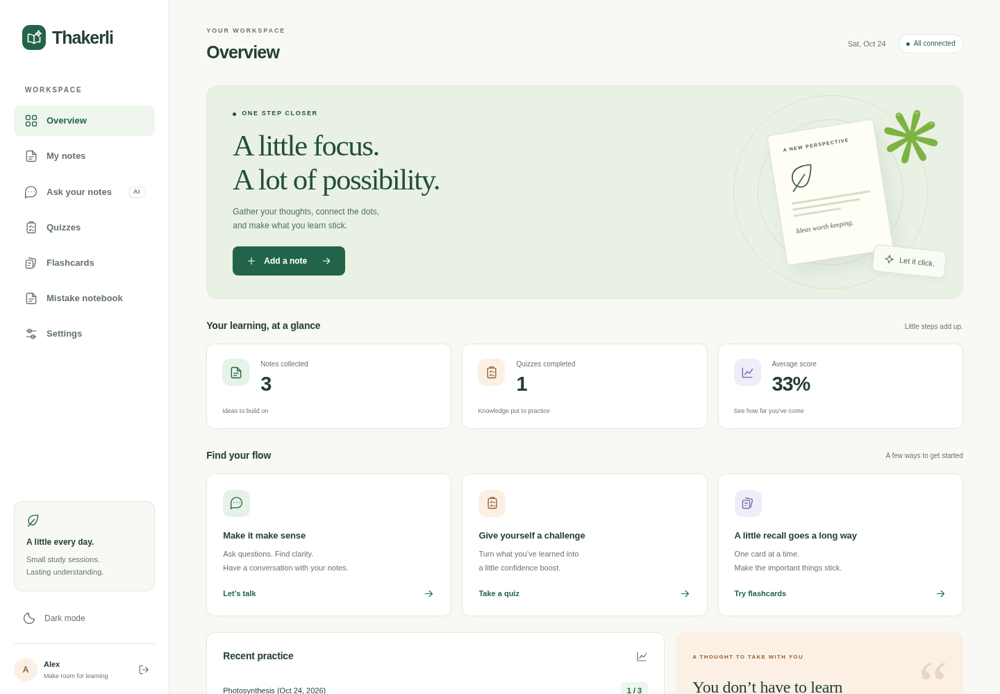

<h1 align="center">Thakerli · ذاكرلي</h1>

<strong>Study from your own notes, in Arabic or English.</strong>

  
  
  

*Thakerli’s overview screen with sample study data.*

## What is Thakerli?

Thakerli is a bilingual AI study assistant. Students can upload text or PDF notes, ask questions about them, and open the source excerpts behind each answer. They can also turn their material into quizzes and flashcards and come back to saved practice later.

| When you want to… | In Thakerli you can… |
| --- | --- |
| Find something in your notes | Search by content or subject and open the original note. |
| Understand a topic | Ask a question and follow the excerpts cited in the answer. |
| Practice and review | Save quizzes and flashcards, track progress, and revisit missed questions. |

## Tech stack

| Layer | Technologies | Role |
| --- | --- | --- |
| Web interface | HTML, CSS, JavaScript | Study workspace with Arabic right-to-left layouts and English screens. |
| Application and API | Python, FastAPI | Notes, chat, quiz and flashcard workflows. |
| Data | SQLite, PostgreSQL | Local and hosted storage for study material and progress. |
| Model providers | Groq, Ollama | Hosted inference and local model support. |

## What I built

I built the study workspace and integrated Groq and Ollama. I focused on keeping answers traceable to the original notes and saving generated study sets so students could review them again.
